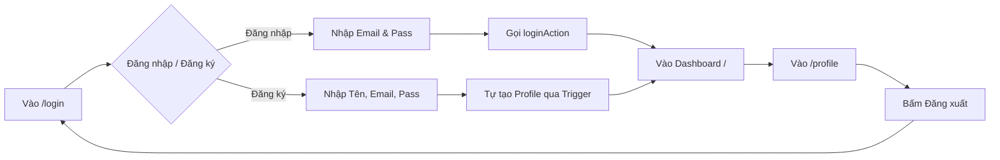
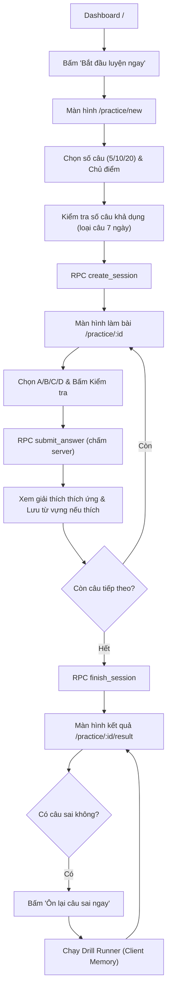
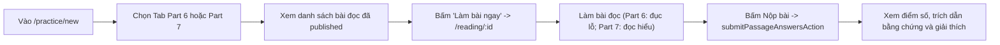
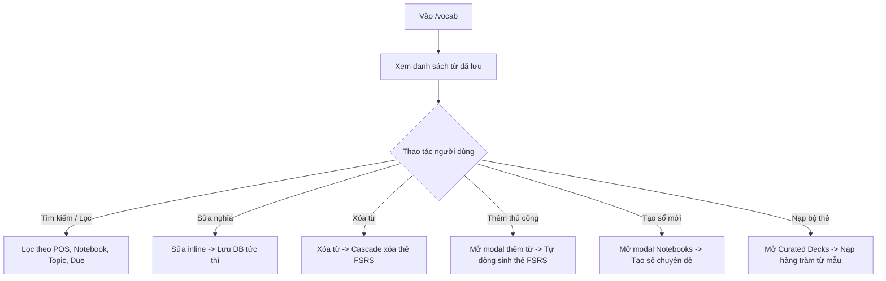
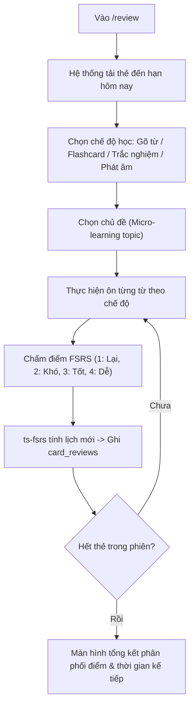
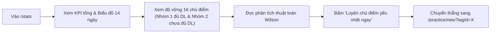
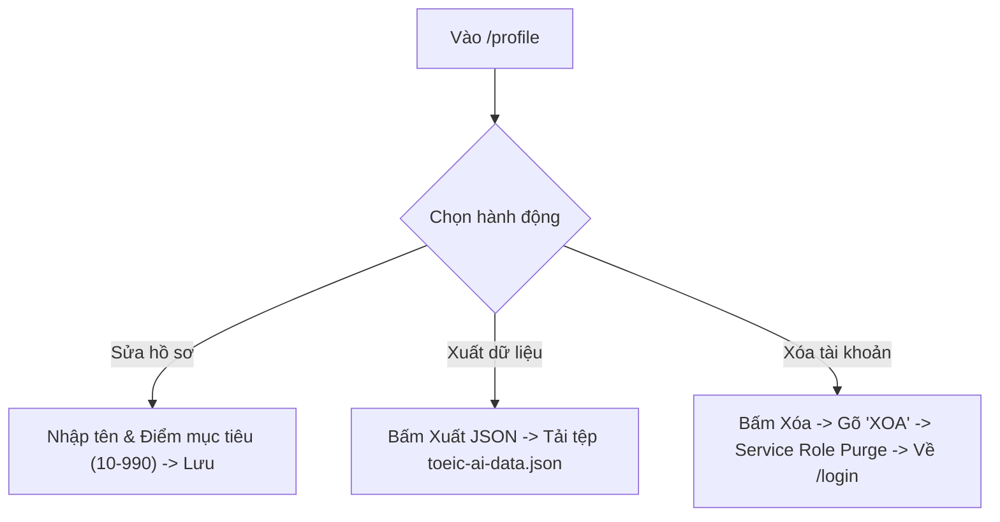
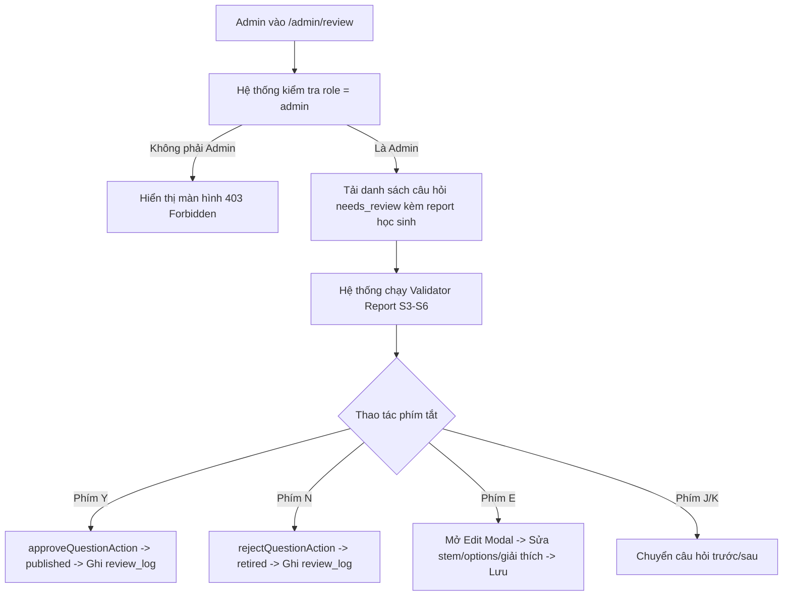

# BẢN KIỂM KÊ TÍNH NĂNG ĐÃ TRIỂN KHAI (FEATURE INVENTORY)

> **Dự án:** Hệ thống Luyện thi TOEIC Thích ứng (TOEIC AI Platform)  
> **Thời điểm kiểm kê:** Tháng 10/2026  
> **Phương pháp kiểm kê:** Phân tích trực tiếp 100% mã nguồn hiện có trong thư mục `src/`, `supabase/migrations/`, `scripts/`, `tests/` và `data/`.  
> **Nguyên tắc thực hiện:** Chỉ ghi nhận những gì có bằng chứng rõ ràng trong mã nguồn. Không suy diễn, không đánh đồng giao diện với logic nghiệp vụ, không đưa ra đề xuất hay cải tiến.

---

## A. TỔNG QUAN TÍNH NĂNG

Dựa trên việc đọc và phân tích toàn bộ mã nguồn của dự án, hệ thống hiện có **9 nhóm tính năng chính** đã được triển khai mã nguồn và kiểm chứng qua 17 bộ test tự động (130 test cases):

1. **Xác thực & Quản lý Phiên Người dùng (Authentication & Session Guard):** Đăng nhập, đăng ký, đăng xuất, đồng bộ token JWT qua cookie với Supabase SSR, bảo vệ route tập trung.
2. **Tổng quan Học tập & Lộ trình Thích ứng (Dashboard & Adaptive Recommendation):** Theo dõi chuỗi ngày học liên tục (streak), nhắc nhở thẻ từ vựng đến hạn FSRS, gợi ý bài luyện Part 5 theo chủ điểm yếu nhất, top 3 chủ điểm cần chú ý, biểu đồ tần suất học 14 ngày.
3. **Luyện tập Part 5 Thích ứng (Adaptive Part 5 Practice Engine):** Khởi tạo phiên luyện tập (5/10/20 câu), lọc trừ câu làm đúng trong 7 ngày trượt, nộp bài từng câu với đáp án bảo mật tại server, giải thích thích ứng mở rộng/thu gọn, lưu từ vựng nhanh từ câu hỏi, báo lỗi câu hỏi, tổng kết kết quả phiên và luyện củng cố (Drill) client-side.
4. **Luyện tập Đọc hiểu Part 6 & Part 7 (Reading Comprehension Engine):** Luyện tập điền đoạn văn Part 6 với ô đục lỗ tương tác trực tiếp `[131]-[134]`, luyện tập đọc hiểu Part 7 đa văn bản (email, memo, notice, article...), đối chiếu đáp án trên server.
5. **Sổ Từ vựng Cá nhân & Quản lý Thư mục (Vocab Notebooks & Custom Decks):** Lưu từ đơn/lưu hàng loạt, phân loại từ loại kép (Dual POS), tra cứu ngữ âm kép, chỉnh sửa nghĩa inline, phân loại theo Sổ từ vựng (Notebooks), nạp bộ thẻ mẫu chuẩn (Curated Decks: 600 từ thiết yếu, Từ vựng Part 5, IT, Idioms).
6. **Hệ thống Ôn tập Ngắt quãng Đa năng (Versatile FSRS Spaced Repetition Suite):** 4 chế độ học (Gõ từ / Lật flashcard / Trắc nghiệm / Luyện phát âm), thuật toán FSRS (ts-fsrs v5.4.2) với 4 mức đánh giá (Again, Hard, Good, Easy), thuật toán phát hiện lỗi gõ phím nhẹ (Levenshtein), hệ thống gợi ý ký tự từng nấc, chia nhỏ kho từ thành các chủ đề nhỏ (Micro-learning topics).
7. **Thống kê & Chẩn đoán Độ vững Kỹ năng (Adaptive Rolling Mastery & Wilson Analytics):** Đo lường độ vững 16 chủ điểm ngữ pháp TOEIC theo mô hình Cận dưới Wilson kết hợp cửa sổ trượt 20 câu và fast-track (D-25), phân nhóm Đủ dữ liệu (≥5 câu) và Chưa đủ dữ liệu (<5 câu), chẩn đoán chủ điểm yếu nhất.
8. **Hồ sơ Cá nhân & Quyền riêng tư (User Profile, Data Portability & Account Deletion):** Cập nhật tên hiển thị và điểm mục tiêu (10-990), xuất toàn bộ dữ liệu cá nhân dạng JSON (Data Portability), xóa vĩnh viễn tài khoản 2 lớp xác nhận (gõ "XOA") qua Supabase Admin Client.
9. **Hàng đợi Duyệt Đề Quản trị viên (Admin Question Review Queue):** Kiểm tra phân quyền admin, duyệt câu hỏi trạng thái `needs_review`/`draft`, bộ kiểm định tự động 4 tiêu chí S3-S6, phím tắt thao tác nhanh (J/K/Y/N/E), chế độ chỉnh sửa câu hỏi trực tiếp (Edit Mode), ghi nhận nhật ký duyệt `review_log`.

---

## B. DANH MỤC TÍNH NĂNG THEO TỪNG MODULE

### 1. Module Xác thực & Tài khoản (Authentication)

#### 1.1. Đăng nhập Email & Mật khẩu
- **Mô tả:** Cho phép người dùng đăng nhập vào hệ thống bằng tài khoản email và mật khẩu đã đăng ký.
- **Vị trí:** Trang `/login` (chế độ "Đăng nhập").
- **Cách sử dụng:** Nhập email, mật khẩu và nhấn nút "Đăng nhập". Hệ thống chuyển hướng về trang chủ `/` nếu thành công, hoặc hiển thị thông báo lỗi "Email hoặc mật khẩu không đúng" nếu thất bại.
- **Logic xử lý:** Gọi `signInWithPassword` của Supabase Auth qua Server Action `loginAction`. Khi thành công, revalidate layout và redirect về `/`.
- **Dữ liệu liên quan:** Đọc bảng `auth.users`, tạo/cập nhật session cookie.
- **Tệp mã nguồn liên quan:** `src/app/(auth)/login/page.tsx`, `src/features/auth/actions.ts`.
- **Trạng thái:** Đã triển khai logic.

#### 1.2. Đăng ký tài khoản mới
- **Mô tả:** Cho phép người học tạo tài khoản mới với họ tên, email và mật khẩu (tối thiểu 6 ký tự).
- **Vị trí:** Trang `/login` (chế độ "Đăng ký").
- **Cách sử dụng:** Chuyển sang tab "Đăng ký", nhập họ tên, email, mật khẩu và bấm "Đăng ký".
- **Logic xử lý:** Kiểm tra định dạng dữ liệu (mật khẩu ≥ 6 ký tự), gọi `signUp` của Supabase Auth qua `signupAction`. Trigger database tự động khởi tạo bản ghi trong bảng `profiles` với vai trò mặc định `student`.
- **Dữ liệu liên quan:** Tạo mới trong `auth.users`, trigger chèn vào bảng `public.profiles`.
- **Tệp mã nguồn liên quan:** `src/app/(auth)/login/page.tsx`, `src/features/auth/actions.ts`, `supabase/migrations/20261025000001_initial_schema.sql`.
- **Trạng thái:** Đã triển khai logic.

#### 1.3. Đăng xuất tài khoản
- **Mô tả:** Xóa phiên làm việc hiện tại và chuyển người dùng về màn hình đăng nhập.
- **Vị trí:** Trang Hồ sơ `/profile` (nút "Đăng xuất").
- **Cách sử dụng:** Người dùng nhấn nút "Đăng xuất" ở trang `/profile`, hệ thống đăng xuất và chuyển hướng về `/login`.
- **Logic xử lý:** Gọi `supabase.auth.signOut()` qua Server Action `logoutAction`, xóa cookie session và redirect về `/login`.
- **Dữ liệu liên quan:** Hủy session token trong cookies.
- **Tệp mã nguồn liên quan:** `src/features/auth/actions.ts`, `src/features/profile/components/profile-view.tsx`.
- **Trạng thái:** Đã triển khai logic.

#### 1.4. Bảo vệ phiên và đồng bộ Token (Auth Middleware)
- **Mô tả:** Tự động làm mới session JWT trên từng request và đồng bộ cookie phiên giữa Server và Client.
- **Vị trí:** Toàn bộ ứng dụng (Next.js Middleware).
- **Cách sử dụng:** Hoạt động ngầm, người dùng không cần thao tác thủ công.
- **Logic xử lý:** Sử dụng `@supabase/ssr` `createServerClient` để đọc và ghi cookies, gọi `supabase.auth.getUser()` bọc trong khối `try...catch` để không làm sập ứng dụng nếu có sự cố mạng.
- **Dữ liệu liên quan:** Cookies trình duyệt (`sb-*-auth-token`).
- **Tệp mã nguồn liên quan:** `src/middleware.ts`, `src/lib/supabase/server.ts`, `src/lib/supabase/client.ts`.
- **Trạng thái:** Đã triển khai logic.

---

### 2. Module Tổng quan Học tập (Dashboard)

#### 2.1. Theo dõi Chuỗi ngày học liên tục (Streak Counter)
- **Mô tả:** Đếm và hiển thị số ngày học liên tục gần nhất của người dùng.
- **Vị trí:** Đầu trang Dashboard `/`.
- **Cách sử dụng:** Hiển thị tự động khi vào trang chủ. Nếu chuỗi > 0, hiển thị số ngày kèm icon ngọn lửa; nếu bằng 0, hiển thị lời kêu gọi khởi động.
- **Logic xử lý:** Trong `getDashboardSummaryAction`, truy vấn các mốc thời gian `created_at` trong bảng `attempts`, quy đổi theo múi giờ `Asia/Ho_Chi_Minh`, lập tập hợp các ngày duy nhất và đếm lùi liên tục từ hôm nay/hôm qua.
- **Dữ liệu liên quan:** Đọc bảng `public.attempts`.
- **Tệp mã nguồn liên quan:** `src/features/stats/actions.ts`, `src/features/dashboard/components/dashboard-view.tsx`.
- **Trạng thái:** Đã triển khai logic.

#### 2.2. Thẻ Đề xuất Luyện tập Part 5 (Hero Recommendation Card)
- **Mô tả:** Gợi ý chủ điểm ngữ pháp ưu tiên cần luyện tập dựa trên chẩn đoán điểm yếu nhất của người học hoặc gợi ý chủ điểm mặc định cho người mới.
- **Vị trí:** Cột trái màn hình Dashboard `/` (chứa nút Primary duy nhất của màn hình).
- **Cách sử dụng:** Người học nhấn nút "Bắt đầu luyện 10 câu ngay →" để đi thẳng vào trang khởi tạo phiên với chủ điểm được gợi ý điền sẵn.
- **Logic xử lý:** Phân tích điểm độ vững Wilson từ `getSkillMasteryStatsAction`. Nếu chưa có dữ liệu, gợi ý chủ điểm phổ biến nhất ("Dạng từ"); nếu đã có dữ liệu, chọn chủ điểm có độ vững thấp nhất trong nhóm đủ dữ liệu.
- **Dữ liệu liên quan:** Đọc bảng `public.grammar_tags`, `public.attempts`.
- **Tệp mã nguồn liên quan:** `src/features/stats/actions.ts`, `src/features/dashboard/components/dashboard-view.tsx`.
- **Trạng thái:** Đã triển khai logic.

#### 2.3. Nhắc nhở Thẻ Ôn tập Đến hạn FSRS (Spaced Repetition Due Card)
- **Mô tả:** Đếm số lượng thẻ từ vựng đã đến lịch cần ôn tập theo thuật toán FSRS.
- **Vị trí:** Cột trái màn hình Dashboard `/`.
- **Cách sử dụng:** Nếu có thẻ đến hạn (`due <= now()`), hiển thị số lượng và nút "Ôn N thẻ ngay →" dẫn tới `/review`. Nếu không có thẻ, hiển thị trạng thái hoàn thành và liên kết mở Sổ từ vựng.
- **Logic xử lý:** Đếm số bản ghi trong bảng `review_cards` có `user_id = auth.uid()` và `due <= now()`.
- **Dữ liệu liên quan:** Đọc bảng `public.review_cards`.
- **Tệp mã nguồn liên quan:** `src/features/stats/actions.ts`, `src/features/dashboard/components/dashboard-view.tsx`.
- **Trạng thái:** Đã triển khai logic.

#### 2.4. Danh sách Top 3 Chủ điểm cần chú ý
- **Mô tả:** Hiển thị 3 chủ điểm ngữ pháp đang có độ vững thấp nhất hoặc đang cần làm thêm câu hỏi để đủ dữ liệu đánh giá.
- **Vị trí:** Cột phải màn hình Dashboard `/`.
- **Cách sử dụng:** Người học xem nhanh độ vững và số câu đã làm của 3 chủ điểm, có nút "Luyện chủ điểm này →" dẫn trực tiếp vào trang tạo phiên.
- **Logic xử lý:** Lấy tối đa 3 chủ điểm từ Nhóm 1 (Đủ dữ liệu, sắp xếp tăng dần theo độ vững), nếu chưa đủ 3 thì bổ sung từ Nhóm 2 (Chưa đủ dữ liệu).
- **Dữ liệu liên quan:** Đọc bảng `public.grammar_tags`, `public.attempts`.
- **Tệp mã nguồn liên quan:** `src/features/stats/actions.ts`, `src/features/dashboard/components/dashboard-view.tsx`.
- **Trạng thái:** Đã triển khai logic.

---

### 3. Module Luyện tập Part 5 Thích ứng (Practice Engine)

#### 3.1. Cấu hình & Khởi tạo Phiên làm bài (Session Setup)
- **Mô tả:** Cho phép người học chọn phần thi (Part 5/6/7), quy mô phiên (5, 10 hoặc 20 câu) và chọn chủ điểm ngữ pháp cụ thể hoặc ngẫu nhiên.
- **Vị trí:** Trang `/practice/new`.
- **Cách sử dụng:** Bấm chọn số lượng câu, chọn 1 trong 16 chủ điểm (hoặc "Tất cả chủ điểm"), xem số lượng câu khả dụng thực tế và bấm nút Primary "Bắt đầu luyện (N câu) →".
- **Logic xử lý:** Gọi Server Action `getPracticeTopicsAction` để đếm số câu khả dụng cho từng chủ điểm (loại trừ các câu đã làm đúng trong 7 ngày gần nhất). Nếu hết câu, hiển thị alert cảnh báo `isOutOfQuestions`. Nếu số câu còn lại ít hơn quy mô đã chọn, hiển thị cảnh báo `isFewerQuestions`. Khi bấm bắt đầu, gọi RPC `create_session` để tạo phiên và lấy danh sách câu hỏi.
- **Dữ liệu liên quan:** Đọc `questions`, `grammar_tags`, `attempts`; ghi vào `practice_sessions`, `session_questions`.
- **Tệp mã nguồn liên quan:** `src/app/practice/new/page.tsx`, `src/features/practice/actions.ts`, `supabase/migrations/20261025000002_seed_and_rpc.sql`.
- **Trạng thái:** Đã triển khai logic.

#### 3.2. Làm bài Tập trung & Nộp câu trả lời (Focused Practice Runner)
- **Mô tả:** Giao diện làm bài tập trung toàn màn hình, hỗ trợ chọn đáp án A/B/C/D, phím tắt, gửi đáp án lên server chấm điểm bảo mật.
- **Vị trí:** Trang `/practice/[id]`.
- **Cách sử dụng:** Học viên bấm chọn phương án bằng chuột hoặc phím `A`, `B`, `C`, `D`, sau đó bấm nút "Kiểm tra đáp án" (hoặc phím `Enter`). Sau khi xem phản hồi, bấm "Câu tiếp theo" (hoặc `Enter`).
- **Logic xử lý:** Quản lý trạng thái bằng `practiceReducer` (`answering`, `submitting`, `feedback`, `error`, `finished`). Khi nộp, gọi RPC `submit_answer` truyền `sessionId`, `questionId`, `selectedIndex`. Server so khớp với bảng `question_answers`, ghi nhận bản ghi vào bảng `attempts`, và trả về kết quả đúng/sai kèm giải thích sư phạm đã qua kiểm định schema Zod (`parseExplanation`).
- **Dữ liệu liên quan:** Đọc `session_questions`, `questions`, `question_answers`; ghi vào `attempts`.
- **Tệp mã nguồn liên quan:** `src/app/practice/[id]/page.tsx`, `src/features/practice/components/practice-runner.tsx`, `src/core/practiceReducer.ts`, `src/features/practice/actions.ts`, `src/features/practice/schemas.ts`.
- **Trạng thái:** Đã triển khai logic.

#### 3.3. Giải thích Thích ứng (Adaptive Explanation Component)
- **Mô tả:** Hiển thị lời giải thích sư phạm theo quy tắc thích ứng: nếu làm sai, tự động bung toàn bộ giải thích; nếu làm đúng, hiển thị thanh tóm tắt thu gọn kèm nút mở rộng.
- **Vị trí:** Trong màn hình làm bài `/practice/[id]` và màn hình kết quả `/practice/[id]/result`.
- **Cách sử dụng:** Người học xem quy tắc ngữ pháp cốt lõi, lý do phương án đúng, dịch nghĩa toàn câu và phân tích vì sao các phương án khác sai. Có nút "Mở rộng giải thích chi tiết" khi làm đúng.
- **Logic xử lý:** Kiểm tra cờ `isCorrect`. Nếu `false`, `isExpanded` mặc định là `true`. Khi mở rộng, kích hoạt hàm ghi nhận sự kiện phân tích `explanation_expand_clicked`.
- **Dữ liệu liên quan:** Dữ liệu giải thích từ `SubmitAnswerResponse["explanation"]`.
- **Tệp mã nguồn liên quan:** `src/features/practice/components/adaptive-explanation.tsx`, `src/features/practice/schemas.ts`.
- **Trạng thái:** Đã triển khai logic.

#### 3.4. Lưu nhanh Từ vựng từ Câu hỏi (Word Chips & Quick Save)
- **Mô tả:** Cho phép người học lưu nhanh các từ vựng trọng tâm xuất hiện trong câu hỏi vào Sổ từ cá nhân.
- **Vị trí:** Phía dưới khối giải thích ở màn hình làm bài và thanh công cụ đầu câu.
- **Cách sử dụng:** Bấm vào thẻ từ gợi ý (Word Chip) hoặc nút "+ Lưu từ", mở modal lưu từ với các trường từ, nghĩa, phiên âm và câu ngữ cảnh điền sẵn.
- **Logic xử lý:** Trích xuất từ vựng từ `explanation.vocab_hints`. Khi mở modal, tự động thay thế chỗ trống `______` trong câu đề bài bằng đáp án đúng thông qua hàm `completeStemWithAnswer` để tạo ngữ cảnh hoàn chỉnh.
- **Dữ liệu liên quan:** Ghi vào `public.vocab_entries`, kích hoạt trigger tạo thẻ trong `public.review_cards`.
- **Tệp mã nguồn liên quan:** `src/features/practice/components/practice-runner.tsx`, `src/features/vocab/components/vocab-save-modal.tsx`, `src/core/vocab.ts`.
- **Trạng thái:** Đã triển khai logic.

#### 3.5. Báo lỗi Câu hỏi (Question Reporting)
- **Mô tả:** Cho phép học viên báo cáo câu hỏi có vấn đề học thuật (nhiều đáp án đúng, không đáp án nào đúng, lỗi chính tả, câu hỏi mơ hồ...).
- **Vị trí:** Nút "Báo lỗi" ở góc phải thẻ câu hỏi sau khi nộp bài.
- **Cách sử dụng:** Bấm "Báo lỗi", chọn 1 trong 5 lý do, nhập ghi chú tối đa 200 ký tự và bấm "Gửi báo cáo".
- **Logic xử lý:** Gọi Server Action `reportQuestionAction`. Kiểm tra trùng lặp báo cáo đang pending của user. Ghi bản ghi vào bảng `question_reports`. Khi có từ 3 báo cáo cùng lý do, trigger database tự động đưa câu hỏi về trạng thái `needs_review`.
- **Dữ liệu liên quan:** Ghi vào `public.question_reports`, cập nhật `public.questions.status`.
- **Tệp mã nguồn liên quan:** `src/features/practice/components/question-report-modal.tsx`, `src/features/practice/actions.ts`, `supabase/migrations/20261025000001_initial_schema.sql`.
- **Trạng thái:** Đã triển khai logic.

#### 3.6. Tổng kết Phiên làm bài (Practice Result View)
- **Mô tả:** Hiển thị bảng tổng kết số câu đúng/sai, độ chính xác (%), thời gian làm bài, danh sách toàn bộ các câu hỏi kèm bộ lọc (Tất cả / Chỉ xem câu sai).
- **Vị trí:** Trang `/practice/[id]/result`.
- **Cách sử dụng:** Tự động hiển thị sau khi hoàn thành câu cuối của phiên. Người học có thể lọc xem lại các câu sai, mở xem giải thích từng câu, lưu từ vựng hoặc kích hoạt chế độ Drill.
- **Logic xử lý:** Gọi RPC `get_session_review` để lấy toàn bộ thông tin câu hỏi, đáp án học viên chọn, đáp án đúng và phân tích giải thích.
- **Dữ liệu liên quan:** Đọc `practice_sessions`, `session_questions`, `questions`, `question_answers`, `attempts`.
- **Tệp mã nguồn liên quan:** `src/app/practice/[id]/result/page.tsx`, `src/features/practice/components/practice-result-view.tsx`, `src/features/practice/actions.ts`.
- **Trạng thái:** Đã triển khai logic.

#### 3.7. Luyện tập Củng cố Tức thì (Drill Runner)
- **Mô tả:** Chế độ làm lại ngay các câu hỏi bị sai trong phiên vừa hoàn thành, hoàn toàn độc lập và không ảnh hưởng đến điểm kỹ năng.
- **Vị trí:** Nút "Ôn lại N câu sai ngay" tại màn hình kết quả `/practice/[id]/result`.
- **Cách sử dụng:** Học viên bấm nút kích hoạt Drill, giao diện chuyển sang chế độ làm lại các câu sai với banner cảnh báo rõ ràng. Làm xong có màn hình tổng kết độ chính xác lượt Drill và nút quay lại kết quả phiên.
- **Logic xử lý:** Vận hành hoàn toàn bằng state trên client memory (`drillReducer`, `src/core/drill.ts`). Tuân thủ bất biến PD-03: Tuyệt đối không ghi bản ghi vào bảng `attempts`, không gọi RPC `submit_answer`, không thay đổi độ vững kỹ năng (Mastery).
- **Dữ liệu liên quan:** Chỉ lưu trữ trong RAM trình duyệt, không tác động DB.
- **Tệp mã nguồn liên quan:** `src/core/drill.ts`, `src/features/practice/components/drill-runner.tsx`.
- **Trạng thái:** Đã triển khai logic.

---

### 4. Module Luyện tập Đọc hiểu Part 6 & Part 7 (Reading Engine)

#### 4.1. Luyện tập Điền đoạn văn Part 6 (Text Completion)
- **Mô tả:** Đọc đoạn văn bản thương mại (memo, email, notice...) có 4 chỗ đục lỗ `[131]`, `[132]`, `[133]`, `[134]` và chọn phương án điền từ phù hợp.
- **Vị trí:** Trang `/reading/[id]` (với bài đọc có `part = 6`).
- **Cách sử dụng:** Người học đọc bài văn bên trái, bấm vào các ô đục lỗ tương tác trong bài hoặc chọn câu hỏi bên phải, chọn đáp án A/B/C/D cho từng chỗ trống, sau đó bấm "Nộp bài & Chấm điểm".
- **Logic xử lý:** Hàm `tokenizePart6Content` bóc tách văn bản thành các TextToken và BlankToken. Giao diện đồng bộ vị trí câu hỏi đang active. Khi nộp, gọi Server Action `submitPassageAnswersAction` để chấm điểm tập trung tại server.
- **Dữ liệu liên quan:** Đọc `public.passages`, `public.questions`, `public.question_answers`; ghi vào `public.attempts` nếu đã đăng nhập.
- **Tệp mã nguồn liên quan:** `src/core/passages.ts`, `src/features/reading/actions.ts`, `src/features/reading/components/part6-view.tsx`, `src/app/reading/[id]/page.tsx`.
- **Trạng thái:** Đã triển khai logic.

#### 4.2. Luyện tập Đọc hiểu Văn bản Part 7 (Reading Comprehension)
- **Mô tả:** Đọc hiểu văn bản đơn hoặc đa văn bản (bài báo, thư từ, lịch trình...) và trả lời các câu hỏi đọc hiểu kèm theo.
- **Vị trí:** Trang `/reading/[id]` (với bài đọc có `part = 7`).
- **Cách sử dụng:** Đọc nội dung văn bản kèm huy hiệu thể loại bài đọc, trả lời lần lượt các câu hỏi trắc nghiệm bên dưới hoặc bên cạnh, sau đó nộp bài để xem điểm và phân tích.
- **Logic xử lý:** Hiển thị nội dung định dạng theo chuẩn WCAG, chấm điểm server-side qua `submitPassageAnswersAction`. Trả về câu trích dẫn bằng chứng và giải thích chi tiết.
- **Dữ liệu liên quan:** Đọc `public.passages`, `public.questions`, `public.question_answers`; ghi vào `public.attempts`.
- **Tệp mã nguồn liên quan:** `src/core/passages.ts`, `src/features/reading/actions.ts`, `src/features/reading/components/part7-view.tsx`, `src/app/reading/[id]/page.tsx`.
- **Trạng thái:** Đã triển khai logic.

---

### 5. Module Sổ Từ vựng Cá nhân (Vocabulary Management)

#### 5.1. Danh sách Từ vựng & Bộ lọc Đa tiêu chí
- **Mô tả:** Quản lý toàn bộ kho từ vựng cá nhân đã lưu, hỗ trợ tìm kiếm từ khóa và lọc đa chiều.
- **Vị trí:** Trang `/vocab`.
- **Cách sử dụng:** Tìm kiếm theo từ hoặc nghĩa; lọc theo tab "Tất cả" hoặc "Cần ôn hôm nay"; lọc theo Sổ từ vựng (Notebooks); lọc theo Chủ đề (Topic); lọc theo Từ loại (Danh từ, Động từ, Tính từ, Trạng từ, Cụm từ).
- **Logic xử lý:** Hàm `getVocabListAction` kết hợp query Supabase với kiểm tra `due <= now()`. Hàm `getPosCategory` phân loại từ loại thông minh từ hậu tố tiếng Anh, tiền tố tiếng Việt và tập từ vựng kinh doanh TOEIC.
- **Dữ liệu liên quan:** Đọc `public.vocab_entries`, `public.review_cards`, `public.notebooks`.
- **Tệp mã nguồn liên quan:** `src/app/vocab/page.tsx`, `src/features/vocab/actions.ts`, `src/features/vocab/components/vocab-list-view.tsx`, `src/core/vocab.ts`.
- **Trạng thái:** Đã triển khai logic.

#### 5.2. Chỉnh sửa Nghĩa tại chỗ (Inline Edit)
- **Mô tả:** Cho phép người học sửa nhanh nghĩa tiếng Việt của từ vựng trực tiếp trên dòng danh sách mà không cần mở modal.
- **Vị trí:** Nút icon bút chì trên từng dòng từ vựng tại `/vocab`.
- **Cách sử dụng:** Bấm icon bút chì, ô nhập nghĩa xuất hiện, gõ nghĩa mới và bấm dấu tích xanh để lưu (hoặc dấu X đỏ để hủy).
- **Logic xử lý:** Gọi Server Action `updateVocabMeaningAction`, cập nhật trường `meaning` trong bảng `vocab_entries` theo `user_id`.
- **Dữ liệu liên quan:** Cập nhật bảng `public.vocab_entries`.
- **Tệp mã nguồn liên quan:** `src/features/vocab/actions.ts`, `src/features/vocab/components/vocab-list-view.tsx`.
- **Trạng thái:** Đã triển khai logic.

#### 5.3. Xóa Từ vựng khỏi Sổ cá nhân
- **Mô tả:** Xóa từ vựng không còn nhu cầu học, tự động xóa liên đới thẻ ôn tập FSRS.
- **Vị trí:** Icon thùng rác trên từng thẻ từ vựng tại `/vocab`.
- **Cách sử dụng:** Bấm icon thùng rác, hệ thống yêu cầu xác nhận nhanh, bấm xác nhận để xóa.
- **Logic xử lý:** Gọi Server Action `deleteVocabAction`. Database kích hoạt xóa `ON DELETE CASCADE` tự động loại bỏ bản ghi trong `review_cards` và `card_reviews`.
- **Dữ liệu liên quan:** Xóa bản ghi trong `public.vocab_entries`, cascade xóa `public.review_cards`.
- **Tệp mã nguồn liên quan:** `src/features/vocab/actions.ts`, `src/features/vocab/components/vocab-list-view.tsx`.
- **Trạng thái:** Đã triển khai logic.

#### 5.4. Xem Chi tiết Từ vựng (Vocab Detail Modal)
- **Mô tả:** Xem toàn bộ thông tin học thuật chuyên sâu của từ: phiên âm IPA, từ loại, nghĩa tiếng Việt, câu ví dụ kèm dịch nghĩa, từ đồng nghĩa, trái nghĩa, họ từ (Word Family) và cụm cố định (Collocations).
- **Vị trí:** Bấm vào thẻ từ bất kỳ tại `/vocab`.
- **Cách sử dụng:** Modal xuất hiện hiển thị đầy đủ thông tin chi tiết và nút phát âm âm thanh.
- **Logic xử lý:** Tự động kết hợp dữ liệu từ `metadata` của từ vựng kết hợp bộ bóc tách `enrichVocabMetadata`.
- **Dữ liệu liên quan:** Đọc `metadata` từ `public.vocab_entries`.
- **Tệp mã nguồn liên quan:** `src/features/vocab/components/vocab-detail-modal.tsx`, `src/core/vocabDictionary.ts`.
- **Trạng thái:** Đã triển khai logic.

#### 5.5. Thêm Từ mới Thủ công (Manual Word Creation)
- **Mô tả:** Cho phép người học tự thêm bất kỳ từ vựng mới nào ngoài các từ xuất hiện trong bài thi.
- **Vị trí:** Nút "+ Thêm từ mới" ở góc trên trang `/vocab`.
- **Cách sử dụng:** Nhập từ tiếng Anh, nghĩa tiếng Việt, câu ví dụ (tùy chọn), chọn sổ lưu và bấm "Lưu vào sổ từ".
- **Logic xử lý:** Gọi Server Action `saveVocabAction`. Tự động chuẩn hóa lemma bằng `normalizeLemma`. Kiểm tra ràng buộc duy nhất `unique(user_id, lemma)`. Tự động làm giàu metadata (IPA, collocations, word family) qua `enrichVocabMetadata`. Trigger database tự tạo thẻ FSRS đến hạn ngay.
- **Dữ liệu liên quan:** Ghi vào `public.vocab_entries`, trigger ghi `public.review_cards`.
- **Tệp mã nguồn liên quan:** `src/features/vocab/components/vocab-create-modal.tsx`, `src/features/vocab/actions.ts`.
- **Trạng thái:** Đã triển khai logic.

#### 5.6. Quản lý Sổ từ vựng Tùy chỉnh (Notebooks Manager)
- **Mô tả:** Tạo, xem, đổi màu sắc/icon và xóa các sổ từ vựng chuyên đề (ví dụ: "Từ vựng Hợp đồng", "Từ vựng Logistics", "Từ khó Part 7"...).
- **Vị trí:** Nút "Quản lý Sổ từ" tại `/vocab`.
- **Cách sử dụng:** Bấm nút mở modal, nhập tên sổ, mô tả, chọn màu sắc và bấm "Tạo sổ mới". Có thể xóa sổ (từ vựng trong sổ chuyển về không phân loại).
- **Logic xử lý:** Sử dụng các Server Actions `getNotebooksAction`, `createNotebookAction`, `deleteNotebookAction`, `moveVocabToNotebookAction`.
- **Dữ liệu liên quan:** Đọc, ghi, cập nhật, xóa bảng `public.notebooks`.
- **Tệp mã nguồn liên quan:** `src/features/vocab/components/notebook-manager-modal.tsx`, `src/features/vocab/actions.ts`, `supabase/migrations/20261026000009_custom_notebooks.sql`.
- **Trạng thái:** Đã triển khai logic.

#### 5.7. Nạp Bộ thẻ Mẫu Chuẩn (Curated Decks Importer)
- **Mô tả:** Cho phép người học nạp các bộ từ vựng chuẩn hóa có sẵn vào sổ cá nhân chỉ bằng 1 thao tác (4 bộ có sẵn: 600 từ thiết yếu TOEIC, 350 từ Part 5 hay gặp, Từ vựng Công nghệ Thông tin, Cụm từ & Thành ngữ TOEIC).
- **Vị trí:** Tab "Bộ thẻ mẫu có sẵn" hoặc nút "Nạp bộ thẻ" tại `/vocab`.
- **Cách sử dụng:** Xem danh sách bộ thẻ, số lượng từ, bấm "Nạp vào sổ của tôi". Hệ thống tự động tạo notebook riêng và nạp toàn bộ từ vựng.
- **Logic xử lý:** Gọi Server Action `importCuratedDeckAction`. Lọc trừ các từ người dùng đã có sẵn trong sổ (`existingLemmas`) để không vi phạm ràng buộc unique, sau đó thực hiện batch insert theo từng khối 200 từ (`CHUNK_SIZE = 200`) để tối ưu hiệu năng mạng. Trigger database tự động sinh thẻ FSRS tương ứng.
- **Dữ liệu liên quan:** Ghi vào `public.notebooks`, batch insert vào `public.vocab_entries`, trigger vào `public.review_cards`.
- **Tệp mã nguồn liên quan:** `src/features/vocab/components/curated-decks-modal.tsx`, `src/features/vocab/actions.ts`, `src/data/curated-decks/index.ts`.
- **Trạng thái:** Đã triển khai logic.

---

### 6. Module Ôn tập Ngắt quãng FSRS (Spaced Repetition Suite)

#### 6.1. Hàng đợi Ôn tập Thích ứng & Chia nhỏ Chủ đề (Micro-learning Topics)
- **Mô tả:** Tự động lập hàng đợi các thẻ từ vựng cần ôn hôm nay theo FSRS, hỗ trợ chia kho từ lớn thành các nhóm nhỏ 10-15 từ theo chủ đề công sở.
- **Vị trí:** Màn hình Ôn tập `/review`.
- **Cách sử dụng:** Người học chọn chủ đề muốn ôn ở thanh bên trái hoặc modal bộ lọc, hệ thống tự động nạp thẻ của chủ đề đó và giới hạn số từ mỗi lượt (mặc định 15 từ).
- **Logic xử lý:** Server Action `getReviewCardsAction` và `getReviewTopicsAction`. Hỗ trợ chế độ học bình thường (`due <= now()`) và chế độ học củng cố toàn bộ (`studyAll = true / Cram Mode`).
- **Dữ liệu liên quan:** Đọc `public.review_cards`, `public.vocab_entries`, `public.notebooks`.
- **Tệp mã nguồn liên quan:** `src/app/review/page.tsx`, `src/features/review/actions.ts`, `src/features/review/components/review-view.tsx`.
- **Trạng thái:** Đã triển khai logic.

#### 6.2. Chế độ Gõ từ & Khoảng cách Levenshtein (Typing Mode)
- **Mô tả:** Người học xem câu ngữ cảnh có chỗ trống, gõ từ tiếng Anh cần điền, hệ thống tự động kiểm tra độ chính xác và dung thứ lỗi gõ phím nhẹ (Typo Tolerance).
- **Vị trí:** Chế độ mặc định trong `/review`.
- **Cách sử dụng:** Nhập từ vào ô input và nhấn Enter hoặc nút "Kiểm tra". Bấm nút "Gợi ý" nếu chưa nhớ từ.
- **Logic xử lý:** Hàm `evaluateSpellingInput` tính khoảng cách Levenshtein (`calculateLevenshteinDistance`). Nếu sai 1 ký tự đối với từ ≥ 4 chữ cái, thông báo "Gần đúng! Bạn gõ nhầm 1 ký tự". Hàm `generateHintDisplay` mở dần ký tự theo 4 cấp độ bấm gợi ý (cấp 0: toàn dấu `*`, cấp 1: hiện chữ đầu, cấp 2: hiện chữ đầu và cuối...).
- **Dữ liệu liên quan:** So khớp chuỗi trong client memory, sau đó gửi chấm FSRS lên server.
- **Tệp mã nguồn liên quan:** `src/features/review/components/typing-mode-card.tsx`, `src/core/reviewQuiz.ts`.
- **Trạng thái:** Đã triển khai logic.

#### 6.3. Chế độ Lật Thẻ Flashcard & 4 Nút Chấm FSRS
- **Mô tả:** Lật thẻ hai mặt truyền thống (mặt trước: câu đục lỗ/từ vựng; mặt sau: nghĩa, phiên âm, giải thích) và tự chấm điểm mức độ ghi nhớ theo chuẩn FSRS.
- **Vị trí:** Chế độ "Lật thẻ" trong `/review`.
- **Cách sử dụng:** Bấm vào thẻ hoặc phím `Space` để lật mặt sau; bấm 1 trong 4 nút (hoặc phím số `1`, `2`, `3`, `4`): Lại (Again), Khó (Hard), Tốt (Good), Dễ (Easy). Dưới mỗi nút có hiển thị thời gian ôn kế tiếp (ví dụ: "10 phút", "1 ngày", "4 ngày").
- **Logic xử lý:** Hàm `previewFSRSRatings` tính toán trước khoảng thời gian lặp lại của 4 nút bằng `ts-fsrs`. Khi bấm, gọi Server Action `submitCardRatingAction`, tính toán lại stability, difficulty, reps, lapses và thời điểm `due` mới, cập nhật bảng `review_cards` và ghi lịch sử vào bảng `card_reviews`.
- **Dữ liệu liên quan:** Cập nhật `public.review_cards`, ghi mới vào `public.card_reviews`.
- **Tệp mã nguồn liên quan:** `src/features/review/components/flashcard-mode-card.tsx`, `src/core/fsrs.ts`, `src/features/review/actions.ts`.
- **Trạng thái:** Đã triển khai logic.

#### 6.4. Chế độ Trắc nghiệm 4 Phương án (Quiz Mode)
- **Mô tả:** Sinh câu hỏi trắc nghiệm từ vựng đa chiều (EN -> VI và VI -> EN) với các phương án nhiễu (distractors) hợp lý.
- **Vị trí:** Chế độ "Trắc nghiệm" trong `/review`.
- **Cách sử dụng:** Xem từ/nghĩa câu hỏi, chọn 1 trong 4 phương án hiển thị (hoặc phím `1`, `2`, `3`, `4`). Hệ thống báo đúng/sai ngay lập tức.
- **Logic xử lý:** Hàm `generateQuizQuestion` và `generateReverseQuizQuestion` trong `src/core/reviewQuiz.ts` tự động lấy các từ khác trong hàng đợi làm phương án gây nhiễu, xáo trộn vị trí ngẫu nhiên.
- **Dữ liệu liên quan:** Client memory kết hợp gọi `submitCardRatingAction`.
- **Tệp mã nguồn liên quan:** `src/features/review/components/quiz-mode-card.tsx`, `src/core/reviewQuiz.ts`.
- **Trạng thái:** Đã triển khai logic.

#### 6.5. Chế độ Luyện Phát âm (Speaking Mode)
- **Mô tả:** Người học nghe phát âm mẫu và bấm micro để đọc lại từ vựng, hệ thống nhận diện giọng nói và chấm điểm khớp âm.
- **Vị trí:** Chế độ "Phát âm" trong `/review`.
- **Cách sử dụng:** Bấm biểu tượng loa để nghe giọng đọc bản xứ US; bấm nút micro, cấp quyền ghi âm và phát âm từ vựng. Hệ thống hiển thị kết quả khớp/chưa khớp.
- **Logic xử lý:** Sử dụng Web Speech API native của trình duyệt (`window.SpeechRecognition` hoặc `window.webkitSpeechRecognition`) với ngôn ngữ `en-US`. So khớp kết quả nhận diện với từ đích, hỗ trợ dung thứ qua khoảng cách Levenshtein.
- **Dữ liệu liên quan:** Tương tác Web Speech API trình duyệt, không lưu file âm thanh vào server.
- **Tệp mã nguồn liên quan:** `src/features/review/components/speaking-mode-card.tsx`, `src/lib/audio.ts`.
- **Trạng thái:** Đã triển khai logic (hoạt động trên các trình duyệt hỗ trợ SpeechRecognition như Chrome, Edge).

#### 6.6. Phát âm Âm thanh Kép & Trọng âm Từ loại Kép (Dual POS Pronunciation)
- **Mô tả:** Tiện ích phát âm giọng bản xứ kết hợp phân biệt trọng âm cho các từ TOEIC vừa là danh từ vừa là động từ (danh từ nhấn âm 1, động từ nhấn âm 2: ví dụ record, contract, present, conduct, produce, project...).
- **Vị trí:** Component `AudioSpeakerButton` dùng chung tại `/vocab`, `/review`, và các modal chi tiết.
- **Cách sử dụng:** Bấm nút loa để nghe phát âm. Với từ loại kép, có nút phát âm danh từ, động từ riêng hoặc nút nghe tuần tự cả hai dạng kèm giải thích phiên âm.
- **Logic xử lý:** Hàm `playPronunciation` ưu tiên phát file MP3 bản xứ từ CDN nếu có, tự động fallback sang HTML5 SpeechSynthesis. Hàm `playDualPronunciation` phát âm danh từ, tạm dừng 750ms và phát âm động từ (kích hoạt bằng tiền tố "to " để ép trình duyệt đổi trọng âm sang âm tiết 2).
- **Dữ liệu liên quan:** Dữ liệu ngữ âm trong `src/core/vocab.ts` (`DUAL_PRONUNCIATION_MAP`) và `src/lib/audio.ts`.
- **Tệp mã nguồn liên quan:** `src/lib/audio.ts`, `src/components/ui/audio-speaker-button.tsx`, `src/core/vocab.ts`.
- **Trạng thái:** Đã triển khai logic.

---

### 7. Module Thống kê & Chẩn đoán Điểm số (Mastery & Analytics)

#### 7.1. Chẩn đoán Độ vững Kỹ năng Thích ứng (Adaptive Rolling Mastery - ARM)
- **Mô tả:** Tính toán và phân loại mức độ thành thạo của học viên trên toàn bộ 16 chủ điểm ngữ pháp TOEIC theo mô hình khoa học 3 tầng (D-25).
- **Vị trí:** Trang `/stats`.
- **Cách sử dụng:** Xem danh sách 16 chủ điểm được chia thành 2 nhóm: Nhóm 1 (Đủ dữ liệu ≥ 5 câu, hiển thị phần trăm độ vững, huy hiệu phân loại, thanh tiến độ 8px và nút luyện tập trực tiếp); Nhóm 2 (Chưa đủ dữ liệu < 5 câu, hiển thị số câu cần làm thêm).
- **Logic xử lý:** Thuật toán trong `src/core/wilson.ts`:
  1. *Tầng 1:* Khởi động ($n < 5$): nhãn "Đang khởi động" (`insufficient`), màu xám trung tính.
  2. *Tầng 2:* Fast-track ($n \ge 8$ và tỷ lệ đúng $\ge 90\%$): thăng hạng thẳng lên "Thành thạo" (`mastered`).
  3. *Tầng 3:* Cửa sổ trượt 20 câu gần nhất kết hợp Cận dưới Wilson với $z = 1.0$ (68% CI):
     - $\text{Score} \ge 75$: "Thành thạo" (`mastered` - xanh ngọc).
     - $50 \le \text{Score} < 75$: "Khá chắc" (`proficient` - hổ phách).
     - $\text{Score} < 50$: "Cần củng cố" (`needs_review` - đỏ nhạt).
- **Dữ liệu liên quan:** Đọc `public.grammar_tags`, `public.attempts`.
- **Tệp mã nguồn liên quan:** `src/core/wilson.ts`, `src/features/stats/actions.ts`, `src/features/stats/components/stats-view.tsx`.
- **Trạng thái:** Đã triển khai logic.

#### 7.2. Biểu đồ Hoạt động 14 Ngày Gần nhất (14-Day Activity Bar Chart)
- **Mô tả:** Biểu đồ cột thể hiện số câu hỏi người dùng đã làm trong từng ngày của 2 tuần gần nhất.
- **Vị trí:** Trang `/stats` và góc trang chủ `/`.
- **Cách sử dụng:** Xem các cột biểu đồ SVG, rê chuột hoặc chạm vào cột để xem số câu cụ thể của ngày đó.
- **Logic xử lý:** Server Action `getDailyActivityStatsAction` lấy số lượng `attempts` trong 14 ngày theo múi giờ `Asia/Ho_Chi_Minh`. Render biểu đồ bằng các thẻ SVG/CSS thuần túy, không dùng thư viện ngoài, chuẩn hóa tỷ lệ theo ngày làm nhiều nhất.
- **Dữ liệu liên quan:** Đọc `public.attempts`.
- **Tệp mã nguồn liên quan:** `src/features/stats/actions.ts`, `src/features/stats/components/stats-view.tsx`.
- **Trạng thái:** Đã triển khai logic.

#### 7.3. Chỉ số KPI Tổng quan & Chẩn đoán Chủ điểm Yếu nhất
- **Mô tả:** Thống kê tổng số câu đã làm, số câu đúng, tỷ lệ chính xác toàn bộ (%) và chỉ rõ chủ điểm yếu nhất cần khắc phục ngay.
- **Vị trí:** Đầu trang `/stats`.
- **Cách sử dụng:** Học viên nắm bắt nhanh hiệu suất tổng thể và bấm nút Primary "Luyện chủ điểm yếu nhất ngay →" để đi thẳng vào luyện tập.
- **Logic xử lý:** Tính toán từ kết quả truy vấn `attempts`, xác định chủ điểm có điểm độ vững thấp nhất trong nhóm đã đủ dữ liệu.
- **Dữ liệu liên quan:** Đọc `public.attempts`, `public.grammar_tags`.
- **Tệp mã nguồn liên quan:** `src/features/stats/actions.ts`, `src/features/stats/components/stats-view.tsx`.
- **Trạng thái:** Đã triển khai logic.

---

### 8. Module Hồ sơ & Quản trị Dữ liệu Cá nhân (Profile & Privacy)

#### 8.1. Cập nhật Thông tin Hồ sơ & Điểm Mục tiêu
- **Mô tả:** Cho phép người học sửa tên hiển thị và điều chỉnh mục tiêu điểm số TOEIC (10 đến 990 điểm).
- **Vị trí:** Trang `/profile`.
- **Cách sử dụng:** Nhập tên mới, nhập điểm mục tiêu (ví dụ: 750) và bấm "Lưu thay đổi".
- **Logic xử lý:** Hàm `validateDisplayName` kiểm tra độ dài (≤ 50 ký tự); hàm `validateTargetScore` kiểm tra số nguyên 10-990. Gọi Server Action `updateProfileAction` cập nhật bảng `profiles`. Bất biến bảo mật: Tuyệt đối không cho phép client cập nhật trường `role`.
- **Dữ liệu liên quan:** Cập nhật `display_name`, `target_score` trong `public.profiles`.
- **Tệp mã nguồn liên quan:** `src/core/profile.ts`, `src/features/profile/actions.ts`, `src/features/profile/components/profile-view.tsx`.
- **Trạng thái:** Đã triển khai logic.

#### 8.2. Xuất Toàn bộ Dữ liệu Cá nhân (JSON Data Portability)
- **Mô tả:** Cho phép học viên tải về toàn bộ dữ liệu học tập cá nhân dưới dạng tệp tin `.json` theo quyền tự chủ dữ liệu cá nhân.
- **Vị trí:** Nút "Xuất dữ liệu học tập (JSON)" tại `/profile`.
- **Cách sử dụng:** Bấm nút, trình duyệt tự động tải xuống tệp `toeic-ai-data-YYYY-MM-DD.json`.
- **Logic xử lý:** Server Action `exportUserDataAction` tập hợp thông tin từ 4 bảng: hồ sơ (`profiles`), sổ từ vựng (`vocab_entries`), thẻ ôn (`review_cards`), và 500 lượt làm bài gần nhất (`attempts`). Trả về chuỗi JSON và tạo URL Blob phía client để kích hoạt tải file.
- **Dữ liệu liên quan:** Đọc `public.profiles`, `public.vocab_entries`, `public.review_cards`, `public.attempts`.
- **Tệp mã nguồn liên quan:** `src/core/profile.ts`, `src/features/profile/actions.ts`, `src/features/profile/components/profile-view.tsx`.
- **Trạng thái:** Đã triển khai logic.

#### 8.3. Xóa Vĩnh viễn Tài khoản (Account Deletion & Data Purge)
- **Mô tả:** Tính năng vùng nguy hiểm (Danger Zone) cho phép xóa sạch tài khoản và toàn bộ lịch sử học tập mà không thể khôi phục.
- **Vị trí:** Khu vực "Vùng nguy hiểm" tại `/profile`.
- **Cách sử dụng:** Bấm "Xóa tài khoản", mở modal cảnh báo 2 lớp, gõ chính xác từ xác nhận "XOA" và bấm nút xác nhận xóa.
- **Logic xử lý:** Hàm `validateDeleteConfirmation` kiểm tra từ khóa "XOA". Server Action `deleteAccountAction` sử dụng `createAdminClient` (Supabase Service Role ở server) để gọi `auth.admin.deleteUser(user.id)`. Cơ sở dữ liệu kích hoạt xóa `ON DELETE CASCADE` dọn dẹp sạch toàn bộ profiles, attempts, vocab_entries, review_cards, practice_sessions. Sau đó hủy cookie và chuyển hướng về `/login?deleted=true`.
- **Dữ liệu liên quan:** Xóa người dùng trong `auth.users`, cascade xóa toàn bộ dữ liệu liên quan trong tất cả các bảng.
- **Tệp mã nguồn liên quan:** `src/core/profile.ts`, `src/features/profile/actions.ts`, `src/lib/supabase/admin.ts`, `src/features/profile/components/profile-view.tsx`.
- **Trạng thái:** Đã triển khai logic.

---

### 9. Module Hàng đợi Quản trị viên (Admin Review Queue)

#### 9.1. Kiểm tra Quyền Quản trị viên & Chặn truy cập (Admin RBAC Guard)
- **Mô tả:** Đảm bảo chỉ tài khoản có vai trò `admin` mới được truy cập vào giao diện hàng đợi duyệt đề.
- **Vị trí:** Trang `/admin/review`.
- **Cách sử dụng:** Tự động kiểm tra khi truy cập. Nếu không phải admin, hiển thị màn hình lỗi 403 Forbidden chuẩn UX.
- **Logic xử lý:** Hàm `checkIsAdmin` kiểm tra `profiles.role = 'admin'`. Các Server Action duyệt đề đều xác thực lại quyền admin trước khi thực thi.
- **Dữ liệu liên quan:** Đọc `public.profiles.role`.
- **Tệp mã nguồn liên quan:** `src/app/admin/review/page.tsx`, `src/features/admin/actions.ts`.
- **Trạng thái:** Đã triển khai logic.

#### 9.2. Duyệt & Kiểm định Câu hỏi (Automated Quality Validation S3-S6)
- **Mô tả:** Giao diện duyệt câu hỏi 2 cột (desktop) hoặc xếp dọc (mobile), hiển thị nội dung câu hỏi, đáp án, giải thích sư phạm, báo cáo lỗi từ học viên và bảng kiểm tra tự động 4 tiêu chí chất lượng.
- **Vị trí:** Trang `/admin/review`.
- **Cách sử dụng:** Admin xem nội dung, đối chiếu báo cáo của học sinh và bảng kiểm tra bên phải, bấm "Duyệt" (phím `Y`) hoặc "Loại" (phím `N`), hoặc chuyển câu bằng phím `J`/`K`.
- **Logic xử lý:** Hàm `runAutomatedValidator` tự động chạy 4 quy tắc kiểm định:
  - *S3 (Chỗ trống):* Phải có đúng 1 chỗ trống (từ 2 dấu gạch dưới `__` trở lên).
  - *S4 (4 phương án):* Đúng 4 phương án, không rỗng, không trùng lặp.
  - *S5 (Chỉ số đáp án):* Số nguyên hợp lệ từ 0 đến 3 (A-D).
  - *S6 (Giải thích sư phạm):* Phải có quy tắc ngữ pháp (`rule_vi`) và lý do vì sao đúng (`why_correct_vi`).
  Hành động Duyệt (`approveQuestionAction`) chuyển `status` sang `published`, giải quyết các `question_reports` liên quan và ghi vào `review_log`. Hành động Loại (`rejectQuestionAction`) chuyển sang `retired` và ghi `review_log`.
- **Dữ liệu liên quan:** Đọc `questions`, `question_answers`, `question_reports`; cập nhật `questions.status`, `question_reports.status`; ghi vào `public.review_log`.
- **Tệp mã nguồn liên quan:** `src/core/adminReview.ts`, `src/features/admin/actions.ts`, `src/features/admin/components/admin-review-view.tsx`.
- **Trạng thái:** Đã triển khai logic.

#### 9.3. Chỉnh sửa Trực tiếp Câu hỏi trong Hàng đợi (Edit Mode)
- **Mô tả:** Cho phép quản trị viên sửa nhanh đề bài, phương án A/B/C/D, chỉ số đáp án đúng hoặc lời giải thích ngay khi đang duyệt mà không cần vào database.
- **Vị trí:** Nút "Sửa câu hỏi" (hoặc phím tắt `E`) tại `/admin/review`.
- **Cách sử dụng:** Bấm "Sửa câu hỏi", form modal mở ra cho phép chỉnh sửa trực tiếp nội dung, sau đó bấm "Lưu thay đổi".
- **Logic xử lý:** Server Action `editQuestionAction` chạy lại kiểm định S3, S4, S5 trên dữ liệu sửa đổi, cập nhật bảng `questions` và `question_answers`, đồng thời ghi nhận hành động `edited` vào bảng `review_log`.
- **Dữ liệu liên quan:** Cập nhật `public.questions`, `public.question_answers`; ghi vào `public.review_log`.
- **Tệp mã nguồn liên quan:** `src/features/admin/components/edit-question-modal.tsx`, `src/features/admin/actions.ts`, `src/core/adminReview.ts`.
- **Trạng thái:** Đã triển khai logic.

---

### 10. Module Tra cứu Từ điển Thông minh (Smart Dictionary)

#### 10.1. Tra cứu Từ vựng Hybrid Cache
- **Mô tả:** Tra cứu nghĩa tiếng Việt, định nghĩa tiếng Anh, phiên âm IPA chuẩn US, phát âm audio, họ từ (Word Family) và collocations cho bất kỳ từ vựng nào.
- **Vị trí:** Server Action dùng chung trong hệ thống (`lookupWordAction`).
- **Cách sử dụng:** Được gọi tự động khi tìm kiếm từ vựng hoặc nhấn tra từ.
- **Logic xử lý:**
  1. Chuẩn hóa từ khóa (`normalizeWord`).
  2. Tra trong bảng đệm `dictionary_cache` của Supabase (truy vấn index $O(\log N)$ dưới 1ms). Nếu có, tăng biến đếm `lookup_count` và trả về kết quả ngay.
  3. Nếu chưa có trong cache: Gọi Free Dictionary API bên ngoài (`https://api.dictionaryapi.dev/api/v2/entries/en/...`) với timeout 3 giây để lấy audio US và định nghĩa tiếng Anh.
  4. Bổ sung nghĩa tiếng Việt, họ từ và collocations từ kho từ vựng TOEIC tuyển chọn `CURATED_TOEIC_TERMS` và bảng phiên âm kép `DUAL_PRONUNCIATION_MAP`.
  5. Tự động lưu bản ghi vào `dictionary_cache` để phục vụ các lần tra cứu sau.
- **Dữ liệu liên quan:** Đọc và ghi bảng `public.dictionary_cache`.
- **Tệp mã nguồn liên quan:** `src/core/dictionary.ts`, `src/features/dictionary/actions.ts`, `supabase/migrations/20261026000008_dictionary_cache.sql`.
- **Trạng thái:** Đã triển khai logic.

---

### 11. Module Đề thi Thử Trọn bộ (Mock Tests Engine - Backend & Data)

#### 11.1. Cấu trúc Đề thi & Quy đổi Thang điểm ETS (Scoring Table)
- **Mô tả:** Bảng quy đổi điểm chuẩn ETS TOEIC từ số câu thô (0-100 câu) sang thang điểm chuẩn (5-495 điểm) cho cả hai kỹ năng Nghe (Listening) và Đọc (Reading).
- **Vị trí:** Module `src/core/toeicScoring.ts`.
- **Cách sử dụng:** Hàm pure function tính toán điểm quy đổi tự động khi chấm đề thi full test.
- **Logic xử lý:** Chứa 2 bảng ánh xạ chuẩn `LISTENING_SCORE_MAP` và `READING_SCORE_MAP` từ 0 đến 100 câu đúng, hàm `calculateTotalScore` trả về tổng điểm thang 990.
- **Dữ liệu liên quan:** Không phụ thuộc database.
- **Tệp mã nguồn liên quan:** `src/core/toeicScoring.ts`, `src/core/toeicScoring.test.ts`.
- **Trạng thái:** Đã triển khai logic.

#### 11.2. Kho Dữ liệu Đề thi Mẫu ETS (Mock Test Sets 1-4)
- **Mô tả:** 4 bộ đề thi mô phỏng đầy đủ cấu trúc TOEIC ETS được lưu trữ dạng tệp tin JSON (Part 1 đến Part 7).
- **Vị trí:** Thư mục `src/data/mock-tests/`.
- **Cách sử dụng:** Dùng làm nguồn dữ liệu nạp vào database và phục vụ thi thử.
- **Logic xử lý:** Quản lý metadata qua `src/data/mock-tests/index.ts` (`MOCK_TESTS`, `getMockTestBySlug`).
- **Dữ liệu liên quan:** 4 tệp JSON: `ets-test-1.json`, `ets-test-2.json`, `ets-test-3.json`, `ets-test-4.json`.
- **Tệp mã nguồn liên quan:** `src/data/mock-tests/index.ts`, `src/types/exam.ts`.
- **Trạng thái:** Đã triển khai logic (Dữ liệu và kiểu dữ liệu sẵn sàng, chưa có giao diện thi thử trên web).

---

## C. CÁC LUỒNG SỬ DỤNG HIỆN CÓ

Dựa trên mã nguồn thực tế, người dùng có thể thực hiện 9 luồng tương tác trọn vẹn từ đầu đến cuối và 1 luồng bị gián đoạn:

### 1. Luồng Xác thực Tài khoản

- **Hiện trạng:** Hoạt động thông suốt. Hỗ trợ hiển thị banner thông báo sau khi tài khoản bị xóa (`/login?deleted=true`).

---

### 2. Luồng Luyện tập Part 5 Thích ứng

- **Hiện trạng:** Hoạt động hoàn chỉnh từ đầu đến cuối. Đáp án được giữ tuyệt đối tại server cho tới khi nộp bài.

---

### 3. Luồng Luyện tập Đọc hiểu Part 6 & Part 7

- **Hiện trạng:** Hoạt động thông suốt. Có sẵn dữ liệu seed bài đọc mẫu trong migration `20261026000010_passages_part6_part7.sql`.

---

### 4. Luồng Quản lý & Học Từ vựng Cá nhân

- **Hiện trạng:** Hoạt động thông suốt. Hỗ trợ phát âm audio kép cho từ loại kép.

---

### 5. Luồng Ôn tập FSRS Ngắt quãng

- **Hiện trạng:** Hoạt động thông suốt với 4 chế độ học tập phong phú.

---

### 6. Luồng Thống kê & Chẩn đoán Kỹ năng

- **Hiện trạng:** Hoạt động thông suốt, liên kết chặt chẽ giữa thống kê và luyện tập.

---

### 7. Luồng Quản lý Hồ sơ & Quyền Riêng tư

- **Hiện trạng:** Hoạt động thông suốt. Tuân thủ tiêu chuẩn an toàn dữ liệu và GDPR-style data portability.

---

### 8. Luồng Duyệt Đề Quản trị viên (Admin Review)

- **Hiện trạng:** Hoạt động thông suốt.

---

### 9. Luồng Tra cứu Từ điển Thông minh (Smart Dictionary Lookup)
- **Mô tả luồng:** Người học gõ từ hoặc bấm Word Chip $\rightarrow$ Kiểm tra cache database $\rightarrow$ Nếu chưa có thì gọi API Free Dictionary bên ngoài $\rightarrow$ Gộp dữ liệu từ kho từ vựng chuyên ngành TOEIC $\rightarrow$ Tự động lưu cache.
- **Hiện trạng:** Hoạt động thông suốt qua Server Action `lookupWordAction`.

---

### 10. Luồng Thi Thử Đề Toàn Diện (Full Mock Tests) — [LUỒNG GIÁN ĐOẠN]
- **Mô tả luồng dự kiến:** Người học vào trang thi thử $\rightarrow$ Chọn đề ETS 1-4 $\rightarrow$ Làm bài 120 phút 200 câu $\rightarrow$ Nộp bài và quy đổi điểm theo thang chuẩn 990.
- **Bằng chứng trong mã nguồn:**
  - Database: Bảng `exam_sets`, `exam_set_answers`, `exam_attempts` đã được tạo đầy đủ trong migration `20261026000012_exam_sets.sql`.
  - Data: 4 bộ đề JSON chuẩn ETS (Listening + Reading) nằm tại `src/data/mock-tests/`.
  - Core logic: Thang quy đổi chuẩn ETS 990 điểm nằm tại `src/core/toeicScoring.ts`.
  - Scripts: Script nạp đề `scripts/ingest-mock-tests.ts` và script kiểm tra `scripts/verify-exam-data.ts`.
- **Điểm gián đoạn:** Chưa có giao diện trang web (chưa có route `/exam` hay `/mock-tests/[id]`). Luồng này hiện chỉ chạy qua backend/scripts, người dùng cuối chưa thể thao tác qua trình duyệt.

---

## D. CÁC CHỨC NĂNG NỀN TẢNG (FOUNDATIONAL CAPABILITIES)

### 1. Cơ chế Xác thực & Phân quyền (Authentication & Authorization)
- **Supabase SSR JWT Cookie Auth:** Quản lý phiên làm việc thông qua cookie mã hóa bảo mật, tương thích hoàn toàn với Next.js App Router (Server Components & Server Actions).
- **Session Auto-Refresh Middleware:** Tự động đồng bộ và gia hạn token trên mỗi request, bắt lỗi kết nối để không làm sập ứng dụng.
- **Hệ thống Vai trò (RBAC):** Bảng `profiles` phân chia 2 vai trò `student` và `admin`. Hàm PostgreSQL `is_admin()` kiểm tra bảo mật ở cấp cơ sở dữ liệu.
- **Bất biến Bảo mật Hồ sơ:** Người dùng chỉ có quyền cập nhật `display_name` và `target_score`; RLS ngăn chặn tuyệt đối việc client tự sửa `role`.

### 2. Các Bất biến Bảo mật Cơ sở Dữ liệu (Database Invariants & RLS)
- **100% Bảng được bảo vệ bằng RLS:** Mọi bảng trong hệ thống (`profiles`, `questions`, `question_answers`, `practice_sessions`, `session_questions`, `attempts`, `question_reports`, `review_log`, `vocab_entries`, `review_cards`, `card_reviews`, `events`, `dictionary_cache`, `notebooks`, `passages`, `exam_sets`, `exam_set_answers`, `exam_attempts`) đều đã bật `ENABLE ROW LEVEL SECURITY`.
- **Đáp án không rời server trước khi nộp:** Bảng `question_answers` và `exam_set_answers` KHÔNG CÓ POLICY SELECT cho vai trò công khai (`anon` và `authenticated`). Chỉ có hàm RPC `SECURITY DEFINER` hoặc tài khoản Admin Service Role ở server mới có thể đọc bảng này để đối chiếu đáp án.
- **Drill không ghi DB, không đổi Mastery:** Chế độ luyện lại câu sai (Drill) chạy hoàn toàn trên client memory, không tạo bản ghi trong bảng `attempts` và không làm thay đổi điểm độ vững kỹ năng.
- **Service Role cô lập tại máy chủ:** `createAdminClient` chỉ được khởi tạo trong môi trường Node.js server; nếu bị import phía client sẽ ngay lập tức ném lỗi ngoại lệ.

### 3. Các Hàm Thủ tục Lưu trữ (Database RPC Functions)
- `create_session(p_tag_id, p_total_questions)`: Khởi tạo phiên luyện tập Part 5, lọc ngẫu nhiên các câu hỏi published, loại bỏ các câu hỏi mà học viên đã làm đúng trong vòng 7 ngày trượt (7x24h), tạo các liên kết trong `session_questions` và trả về danh sách câu hỏi **tuyệt đối không chứa đáp án**.
- `submit_answer(p_session_id, p_question_id, p_selected_index)`: Tiếp nhận đáp án của học viên, đối chiếu với `question_answers`, ghi nhận kết quả vào `attempts`, và trả về kết quả đúng/sai cùng đối tượng giải thích sư phạm thích ứng.
- `finish_session(p_session_id)`: Đánh dấu thời điểm `completed_at` của phiên làm bài.
- `get_session_review(p_session_id)`: Trả về kết quả tổng kết toàn diện của phiên làm bài sau khi hoàn thành.
- `handle_new_vocab_entry()`: Trigger tự động kích hoạt sau khi tạo từ vựng trong `vocab_entries`, tự động chèn 1 bản ghi vào `review_cards` với `due = now()` để đưa từ vào hàng đợi ôn tập ngắt quãng ngay lập tức.

### 4. Các Thuật toán & Logic Nghiệp vụ Lõi (Pure Domain Logic)
- **Adaptive Rolling Mastery (ARM) (`src/core/wilson.ts`):** Tính toán độ vững kỹ năng thích ứng kết hợp Cận dưới khoảng tin cậy Wilson ($z=1.0$), cửa sổ trượt tối đa 20 câu gần nhất và cơ chế Fast-track thăng hạng sớm ($n \ge 8$ và đúng $\ge 90\%$).
- **FSRS Spaced Repetition Engine (`src/core/fsrs.ts`):** Tích hợp thư viện chuẩn `ts-fsrs` (v5.4.2) với `request_retention = 0.9`, tính toán khoảng thời gian lặp lại cho 4 nút và format hiển thị thân thiện tiếng Việt.
- **Phân loại Từ loại & Trọng âm Kép (`src/core/vocab.ts`):** Tự động phát hiện từ loại kép (Danh từ & Động từ, Tính từ & Trạng từ), cung cấp bảng tra cứu ngữ âm kép `DUAL_PRONUNCIATION_MAP` xử lý hiện tượng Initial-stress derivation (danh từ nhấn âm 1, động từ nhấn âm 2).
- **Thuật toán Dung thứ Lỗi gõ phím & Gợi ý Ký tự (`src/core/reviewQuiz.ts`):** Tính khoảng cách Levenshtein giữa từ nhập và từ gốc; sinh chuỗi ký tự gợi ý theo từng nấc bấm.
- **Bảng Chuẩn hóa 16 Chủ điểm Ngữ pháp (`src/core/grammarTags.ts`):** Ánh xạ và chuẩn hóa tên tiếng Việt học thuật cho 16 chủ điểm ngữ pháp TOEIC Part 5 theo tiêu chuẩn ETS.
- **Thang Điểm Quy đổi ETS TOEIC (`src/core/toeicScoring.ts`):** Bảng chuyển đổi điểm thi chuẩn từ số câu đúng sang thang điểm 5-495 cho Listening và Reading.
- **Bộ Kiểm định Tự động S3-S6 (`src/core/adminReview.ts`):** Tự động quét kiểm tra cấu trúc câu hỏi đề thi (1 chỗ trống, 4 lựa chọn không rỗng/trùng, chỉ số đáp án hợp lệ, đầy đủ giải thích sư phạm).
- **Trình Phân tích Đoạn văn Đục lỗ Part 6 (`src/core/passages.ts`):** Bóc tách văn bản chứa các mã đục lỗ `[131]`, `[132]`, `[133]`, `[134]` thành mảng các Token văn bản và Token ô trống tương tác.

### 5. Tích hợp Dịch vụ Bên ngoài (External Integrations)
- **Supabase Cloud / PostgreSQL:** Cơ sở dữ liệu quan hệ chính, lưu trữ bảng, quan hệ, triggers, indexes, RLS và xác thực người dùng.
- **Free Dictionary API (`api.dictionaryapi.dev`):** Tra cứu trực tuyến định nghĩa tiếng Anh và tệp âm thanh phát âm US cho các từ đơn.
- **HTML5 Web Speech API:** Dự phòng phát âm giọng đọc tiếng Anh (`SpeechSynthesis`) và nhận diện giọng nói trong chế độ luyện phát âm (`SpeechRecognition`).

---

## E. CÁC TÍNH NĂNG CHƯA HOÀN THIỆN HOẶC CHỈ CÓ GIAO DIỆN

Dưới đây là danh sách phân loại chi tiết các phần mã nguồn chưa hoàn thiện hoặc chưa có giao diện:

| Tính năng | Trạng thái | Bằng chứng trong mã nguồn | Phần còn thiếu / Điểm hạn chế |
| :--- | :--- | :--- | :--- |
| **Giao diện Thi thử Đề ETS Trọn bộ (Mock Tests UI)** | **Triển khai một phần** | Database migration `20261026000012_exam_sets.sql` có 3 bảng `exam_sets`, `exam_set_answers`, `exam_attempts`; có 4 bộ đề JSON tại `src/data/mock-tests/`; có thang điểm `src/core/toeicScoring.ts`; có script `scripts/ingest-mock-tests.ts`. | **Chưa có giao diện người dùng:** Chưa code trang route hiển thị đề thi trọn bộ (như `/exam` hay `/mock-test/[id]`), người dùng web chưa thể làm đề trọn bộ này. |
| **Nhận diện giọng nói trong Speaking Mode** | **Đã triển khai logic (Phụ thuộc môi trường)** | `src/features/review/components/speaking-mode-card.tsx` đã code đầy đủ logic gọi `SpeechRecognition`/`webkitSpeechRecognition` và so khớp Levenshtein. | Phụ thuộc vào API nhận diện giọng nói của trình duyệt (chỉ chạy tốt trên Chrome/Edge; Firefox và một số trình duyệt di động không hỗ trợ Web Speech API Recognition). Đã có thông báo hướng dẫn và fallback. |
| **Tooling Cào & Xử lý Dữ liệu Ngoại vi (Crawlers & Ingestion Pipelines)** | **Đã triển khai logic (CLI Tools)** | Các scripts tại `scripts/crawler-ets.ts`, `scripts/ingest-huynhduckhoi.ts`, `scripts/ingest-kaggle-toeic.ts`, `scripts/generate-questions-pipeline.ts`. | Là các công cụ dòng lệnh (CLI scripts) chạy offline bằng `tsx` để phục vụ nhà phát triển nạp dữ liệu vào database, không phải tính năng tương tác trên web của học viên. |

---

## F. DANH MỤC TỆP MÃ NGUỒN THEO TÍNH NĂNG

Bảng đối chiếu toàn bộ các tệp mã nguồn then chốt và tính năng tương ứng:

| Tệp mã nguồn | Module / Tính năng trực tiếp tham gia | Trách nhiệm chính |
| :--- | :--- | :--- |
| `src/middleware.ts` | Nền tảng / Xác thực | Lắng nghe request, đồng bộ cookie và token JWT Supabase |
| `src/lib/supabase/server.ts` | Nền tảng / Database | Khởi tạo Supabase Server Client cho Server Components & Actions |
| `src/lib/supabase/client.ts` | Nền tảng / Database | Khởi tạo Supabase Client cho Client Components tương tác trực tiếp |
| `src/lib/supabase/admin.ts` | Nền tảng / Bảo mật | Khởi tạo Service Role Client đặc quyền (chỉ chạy ở Server) |
| `src/lib/audio.ts` | Nền tảng / Âm thanh | Phát âm kép (Dual-Engine Audio): File MP3 CDN & Web Speech API |
| `src/app/(auth)/login/page.tsx` | Xác thực | Giao diện đăng nhập, đăng ký và thông báo xóa tài khoản |
| `src/features/auth/actions.ts` | Xác thực | Server Actions xử lý `loginAction`, `signupAction`, `logoutAction` |
| `src/app/page.tsx` | Dashboard | Server Component tải dữ liệu tổng quan cho trang chủ |
| `src/features/dashboard/components/dashboard-view.tsx` | Dashboard | Giao diện Dashboard: Streak, Hero Card, Thẻ FSRS, Top 3 chủ điểm |
| `src/app/practice/new/page.tsx` | Luyện tập | Giao diện cấu hình phiên Part 5/6/7 và kiểm tra số câu khả dụng |
| `src/app/practice/[id]/page.tsx` | Luyện tập | Server Component nạp câu hỏi bảo mật không lộ đáp án cho Part 5 |
| `src/app/practice/[id]/result/page.tsx` | Luyện tập | Server Component nạp kết quả phiên làm bài Part 5 |
| `src/features/practice/actions.ts` | Luyện tập | Server Actions: `createSessionAction`, `submitAnswerAction`, `finishSessionAction`, `getSessionReviewAction`, `reportQuestionAction`, `getPracticeTopicsAction` |
| `src/features/practice/schemas.ts` | Luyện tập | Schema Zod xác thực cấu trúc dữ liệu giải thích sư phạm an toàn |
| `src/features/practice/components/practice-runner.tsx` | Luyện tập | Trình điều khiển làm bài Part 5, phím tắt A-D/Enter, sticky bar |
| `src/features/practice/components/adaptive-explanation.tsx` | Luyện tập | Hiển thị lời giải thích sư phạm thích ứng mở rộng/thu gọn |
| `src/features/practice/components/answer-option.tsx` | Luyện tập | Component hiển thị 1 phương án lựa chọn với 5 trạng thái trực quan |
| `src/features/practice/components/focused-header.tsx` | Luyện tập | Header tối giản thanh tiến độ và nút thoát an toàn |
| `src/features/practice/components/practice-result-view.tsx` | Luyện tập | Giao diện tổng kết điểm, thời gian, lọc câu sai và kích hoạt Drill |
| `src/features/practice/components/drill-runner.tsx` | Luyện tập | Trình chạy ôn củng cố câu sai trong RAM (không ghi DB) |
| `src/features/practice/components/question-report-modal.tsx` | Luyện tập | Modal báo cáo lỗi câu hỏi học thuật |
| `src/core/practiceReducer.ts` | Luyện tập | State reducer quản lý các pha làm bài trong phiên |
| `src/core/drill.ts` | Luyện tập | Pure logic quản lý chu trình làm bài của Drill |
| `src/app/reading/[id]/page.tsx` | Đọc hiểu Part 6/7 | Server Component điều hướng bài đọc Part 6 hoặc Part 7 |
| `src/features/reading/actions.ts` | Đọc hiểu Part 6/7 | Server Actions lấy danh sách, chi tiết bài đọc và chấm điểm Part 6/7 |
| `src/features/reading/components/part6-view.tsx` | Đọc hiểu Part 6 | Giao diện làm bài đọc điền đoạn văn Part 6 với ô đục lỗ tương tác |
| `src/features/reading/components/part7-view.tsx` | Đọc hiểu Part 7 | Giao diện làm bài đọc hiểu văn bản Part 7 |
| `src/core/passages.ts` | Đọc hiểu Part 6/7 | Bóc tách Token đục lỗ Part 6 và quy đổi nhãn thể loại bài đọc |
| `src/app/vocab/page.tsx` | Từ vựng | Server Component nạp danh sách từ vựng, notebooks và curated decks |
| `src/features/vocab/actions.ts` | Từ vựng | Server Actions: lưu từ đơn, lưu batch, lấy danh sách, sửa nghĩa, xóa từ, quản lý sổ, nạp bộ thẻ mẫu |
| `src/features/vocab/components/vocab-list-view.tsx` | Từ vựng | Giao diện sổ từ cá nhân, tìm kiếm, lọc POS/notebook/topic, inline edit |
| `src/features/vocab/components/vocab-detail-modal.tsx` | Từ vựng | Modal hiển thị chi tiết từ vựng chuyên sâu (IPA, họ từ, collocations) |
| `src/features/vocab/components/vocab-create-modal.tsx` | Từ vựng | Modal thêm từ mới thủ công vào sổ |
| `src/features/vocab/components/vocab-save-modal.tsx` | Từ vựng | Modal lưu từ nhanh xuất hiện trong quá trình làm bài luyện tập |
| `src/features/vocab/components/notebook-manager-modal.tsx`| Từ vựng | Modal quản lý tạo/xóa các sổ từ vựng cá nhân |
| `src/features/vocab/components/curated-decks-modal.tsx` | Từ vựng | Modal xem và nạp các bộ thẻ mẫu chuẩn TOEIC |
| `src/core/vocab.ts` | Từ vựng | Chuẩn hóa lemma, bóc tách từ loại kép (Dual POS) và trọng âm kép |
| `src/core/vocabDictionary.ts` | Từ vựng | Làm giàu metadata từ vựng, tự động sinh giải thích sư phạm tự nhiên |
| `src/app/review/page.tsx` | Ôn tập FSRS | Server Component chuẩn bị hàng đợi thẻ ôn tập và danh sách chủ đề |
| `src/features/review/actions.ts` | Ôn tập FSRS | Server Actions lấy thẻ đến hạn FSRS, chấm thẻ và lấy danh sách topic |
| `src/features/review/components/review-view.tsx` | Ôn tập FSRS | Trình điều hướng ôn tập ngắt quãng 4 chế độ và chia nhỏ chủ đề |
| `src/features/review/components/typing-mode-card.tsx` | Ôn tập FSRS | Thẻ học chế độ Gõ từ, kiểm tra chính tả và gợi ý ký tự từng nấc |
| `src/features/review/components/flashcard-mode-card.tsx`| Ôn tập FSRS | Thẻ học Flashcard lật 2 mặt kèm 4 nút chấm FSRS có xem trước hạn |
| `src/features/review/components/quiz-mode-card.tsx` | Ôn tập FSRS | Thẻ học trắc nghiệm 4 phương án xuôi và đảo |
| `src/features/review/components/speaking-mode-card.tsx`| Ôn tập FSRS | Thẻ học luyện phát âm nhận diện giọng nói qua Web Speech API |
| `src/features/review/components/review-header.tsx` | Ôn tập FSRS | Thanh điều khiển chuyển đổi chế độ học, tiến độ và cài đặt |
| `src/features/review/components/review-settings-modal.tsx`| Ôn tập FSRS | Modal tùy chỉnh tự động phát âm, dung thứ lỗi gõ và tốc độ đọc |
| `src/features/review/components/shortcuts-modal.tsx` | Ôn tập FSRS | Modal tra cứu phím tắt bàn phím theo chuẩn a11y |
| `src/core/fsrs.ts` | Ôn tập FSRS | Cấu hình ts-fsrs, chuyển đổi dữ liệu thẻ DB và tính khoảng thời gian |
| `src/core/reviewQuiz.ts` | Ôn tập FSRS | Thuật toán Levenshtein, đánh giá chính tả, mở gợi ý ký tự, sinh câu hỏi trắc nghiệm |
| `src/app/stats/page.tsx` | Thống kê | Server Component nạp dữ liệu thống kê kỹ năng và tần suất 14 ngày |
| `src/features/stats/actions.ts` | Thống kê | Server Actions tính độ vững 16 chủ điểm Wilson ARM và biểu đồ 14 ngày |
| `src/features/stats/components/stats-view.tsx` | Thống kê | Giao diện báo cáo thống kê, biểu đồ SVG 14 ngày, phân nhóm chủ điểm |
| `src/core/wilson.ts` | Thống kê | Thuật toán Cận dưới Wilson z=1.0, Adaptive Rolling Mastery (D-25) |
| `src/core/math.ts` | Thống kê | Hàm tính tỷ lệ phần trăm chính xác (Accuracy) thuần túy |
| `src/core/grammarTags.ts` | Thống kê / Chung | Định nghĩa chuẩn mực 16 chủ điểm ngữ pháp TOEIC Part 5 |
| `src/app/profile/page.tsx` | Hồ sơ cá nhân | Server Component nạp thông tin hồ sơ người dùng |
| `src/features/profile/actions.ts` | Hồ sơ cá nhân | Server Actions cập nhật hồ sơ, xuất dữ liệu JSON và xóa tài khoản |
| `src/features/profile/components/profile-view.tsx` | Hồ sơ cá nhân | Giao diện hồ sơ, đổi mục tiêu điểm, xuất JSON và modal xóa tài khoản |
| `src/core/profile.ts` | Hồ sơ cá nhân | Kiểm tra hợp lệ tên, điểm mục tiêu (10-990), mã "XOA", đóng gói JSON |
| `src/app/admin/review/page.tsx` | Admin Review | Server Component kiểm tra quyền Admin và tải hàng đợi duyệt đề |
| `src/features/admin/actions.ts` | Admin Review | Server Actions: kiểm tra admin, lấy hàng đợi, duyệt (Y), loại (N), sửa (E) |
| `src/features/admin/components/admin-review-view.tsx` | Admin Review | Giao diện duyệt đề 2 cột, phím tắt J/K/Y/N, bảng kiểm định S3-S6 |
| `src/features/admin/components/edit-question-modal.tsx` | Admin Review | Modal chỉnh sửa trực tiếp nội dung và giải thích câu hỏi |
| `src/core/adminReview.ts` | Admin Review | Bộ kiểm tra tự động 4 quy tắc S3 (blank), S4 (options), S5 (index), S6 (pedagogy) |
| `src/features/dictionary/actions.ts` | Từ điển | Server Action tra cứu từ điển thông minh kết hợp cache DB và FreeDict API |
| `src/core/dictionary.ts` | Từ điển | Chuẩn hóa từ, trích xuất audio US, phân tích kết quả FreeDict và từ điển TOEIC |
| `src/core/toeicScoring.ts` | Đề thi thử | Bảng quy đổi điểm ETS TOEIC Listening & Reading sang thang 990 |
| `src/types/exam.ts` | Đề thi thử | Định nghĩa kiểu dữ liệu đề thi trọn bộ (Part 1 - Part 7) |
| `src/data/mock-tests/index.ts` | Đề thi thử | Quản lý dữ liệu và metadata 4 bộ đề ETS full test |
| `src/components/layout/app-nav.tsx` | Điều hướng UI | Navigation responsive (Sidebar desktop 240px & Bottom bar mobile 56px) |
| `src/components/ui/button.tsx` | Giao diện UI | Nút bấm chuẩn thiết kế (Primary 48px, Secondary 44px, Danger...) |
| `src/components/ui/input.tsx` | Giao diện UI | Ô nhập liệu viền `#8190A6`, cỡ chữ ≥16px chống tự phóng to trên mobile |
| `src/components/ui/card.tsx` | Giao diện UI | Khung thẻ chứa nội dung theo phong cách Swiss LearningGrid |
| `src/components/ui/badge.tsx` | Giao diện UI | Huy hiệu trạng thái tuân thủ bảng màu token chuẩn |
| `src/components/ui/audio-speaker-button.tsx` | Giao diện UI | Nút phát âm tích hợp xử lý từ loại kép và trạng thái loading |

---

## G. TỔNG KẾT & GHI CHÚ KIỂM TRA

1. **Về độ bao phủ kiểm kê:** Đã đọc và rà soát toàn bộ các tệp mã nguồn trong `src/`, các file SQL trong `supabase/migrations/`, các tệp dữ liệu trong `src/data/`, và các file kiểm thử tự động trong `tests/` và `src/core/`.
2. **Những phần không thể kiểm chứng luồng hoạt động trực tiếp trên giao diện người dùng:**
   - **Tính năng Thi Thử Trọn Bộ (Full ETS Mock Tests):** Toàn bộ schema cơ sở dữ liệu (`exam_sets`, `exam_set_answers`, `exam_attempts`), 4 bộ đề JSON nguyên gốc chuẩn ETS, logic quy đổi điểm chuẩn ETS 990 và các script kiểm tra đã hoàn thành đầy đủ, nhưng **chưa có trang UI** trên frontend để học viên làm bài trực tiếp qua trình duyệt.
   - **Các scripts trong thư mục `scripts/`:** Bao gồm các crawler và ETL pipeline (`scripts/crawler-ets.ts`, `scripts/ingest-kaggle-toeic.ts`, `scripts/ingest-huynhduckhoi.ts`, `scripts/generate-questions-pipeline.ts`) là các công cụ chạy bằng dòng lệnh Node.js/tsx độc lập, không kết nối vào giao diện web của người dùng cuối.
   - **Chế độ Luyện phát âm (Speaking Mode):** Logic nhận diện giọng nói dựa trên Web Speech API chuẩn của trình duyệt. Trên môi trường dòng lệnh/test tự động, module này được kiểm thử giao diện và fallback; chất lượng nhận diện thực tế phụ thuộc vào micro và engine SpeechRecognition của trình duyệt người dùng.
